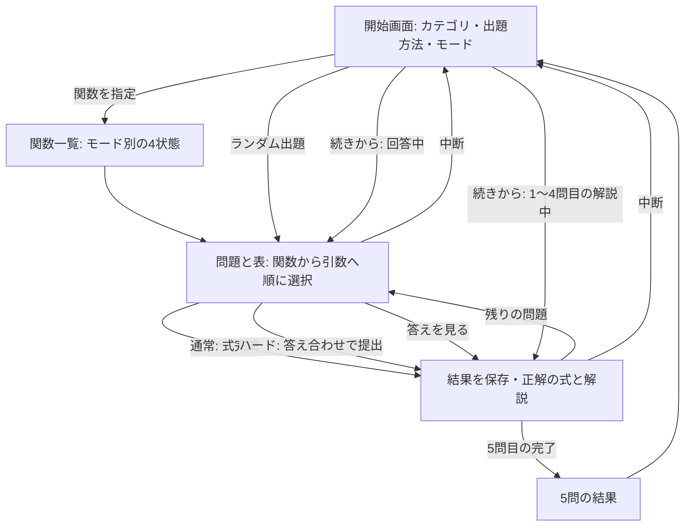

# Excel関数学習: SUM・IFの操作例

[機能仕様](function-practice-spec.md)を具体的な問題に当てはめた操作例と受入確認項目。
仕様の正本は機能仕様のS01〜S11とし、この文書では参照する節と期待結果を示す。
アプリの実装・実行済みテスト・実機検証の結果ではない。カテゴリとExcelの文言の未照合事項は[S01](function-practice-spec.md#s01-目的と対象範囲)と[S04](function-practice-spec.md#s04-回答モードと式表示)を参照する。

## 画面の流れ

通常モードで途中に誤答してから完成した問題は、不正解として解説へ進む（S06）。
再読み込みは、開始画面を経由せず最後に保存できた画面を直接復元する（S08・S09）。
上図はカテゴリ対応後の流れ。照合前のSUM・IF試作ではカテゴリ選択を表示しない（S01）。
各画面の保存に失敗した場合の停止・再試行はS08に従う。

## 回答画面に表示するもの

| 領域 | 内容 |
| --- | --- |
| 上半分 | 問題文、列記号・行番号付きの表。領域内で縦スクロール |
| 下半分 | 組み立て中の式、現在の段階、選択肢、操作ボタン。こちらも独立して縦スクロール |
| 通常モードの引数説明 | Excelの説明に沿った意味を表示。以下の文言は説明用の仮文言 |
| ハードモードの引数説明 | 「第1引数」などの段階だけを表示 |
| 回答後 | 正誤、正解の式、計算結果、関数と引数の説明、該当する誤答の説明 |

選択肢は原則6択・2列×3行。自然な候補が少ない引数のみ2〜5択とする。
以下は内容を示す一覧であり、実際の表示順は問題生成時に決定して保持する。
組み立て中の式は選択した文字列だけで表示し、未選択の等号や閉じ括弧などは補わない。
文字列を連結して見せても、関数と各引数のタップ領域は別にする（S04・S05）。

## 例1: SUM

問題: **全商品の売上の合計を求めてください。**

|   | A | B | C |
| --- | --- | --- | --- |
| 1 | 商品 | 売上 | 個数 |
| 2 | ノート | 1200 | 3 |
| 3 | ペン | 800 | 4 |
| 4 | ファイル | 1500 | 2 |

### 関数を選ぶ

選択肢の例:

| 候補 | 内容の確認 |
| --- | --- |
| `=SUM(` | 正しい関数と記号 |
| `=AVERAGE(` | 平均を求める関数 |
| `=MAX(` | 最大値を求める関数 |
| `SUM(` | 等号がない |
| `=SUM` | 開き括弧がない |
| `=COUNT(` | 数値セルの個数を求める関数 |

「内容の確認」列はこの資料の説明用。回答中の選択肢には表示しない。
正解の `=SUM(` を選んだ時点の式表示は、その文字列のみ。

### 第1引数を選ぶ

通常モードの意味表示例: 「合計する範囲」。
ハードモードでは「第1引数」のみ。

| 候補 | 内容の確認 |
| --- | --- |
| `B2:B4)` | 全商品の売上を含む範囲と閉じ括弧 |
| `B2:B3)` | 最後の商品が含まれない |
| `B3:B4)` | 最初の商品が含まれない |
| `C2:C4)` | 売上ではなく個数の列 |
| `B2:B4,` | 最後に不要なカンマがあり、閉じ括弧がない |
| `B2:B4` | 閉じ括弧がない |

正解の式: `=SUM(B2:B4)`

計算結果: **3500**

解説例: SUMは数値を合計する関数です。売上のあるB2からB4を範囲として指定します。
この問題では範囲を一つ指定するので、最後にカンマを付けず閉じ括弧で終えます。

## 例2: IF

問題: **得点が60以上なら「合格」、それ以外なら「不合格」とC2に表示する式を作ってください。**

|   | A | B | C |
| --- | --- | --- | --- |
| 1 | 氏名 | 得点 | 判定 |
| 2 | 佐藤 | 72 |  |
| 3 | 鈴木 | 58 |  |
| 4 | 高橋 | 60 |  |

### 関数を選ぶ

| 候補 | 内容の確認 |
| --- | --- |
| `=IF(` | 条件に応じて結果を分ける関数 |
| `IF(` | 等号がない |
| `=IF` | 開き括弧がない |
| `=SUM(` | 合計を求める関数 |
| `=COUNT(` | 数値セルの個数を求める関数 |
| `=AVERAGE(` | 平均を求める関数 |

### 第1引数を選ぶ

通常モードの意味表示例: 「判定する条件」。

| 候補 | 内容の確認 |
| --- | --- |
| `B2>=60,` | 60を含む条件と、次の引数へのカンマ |
| `B2>60,` | ちょうど60のときの判定が違う |
| `B2<=60,` | 条件の向きが違う |
| `B3>=60,` | C2と同じ行の得点を参照していない |
| `B2>=60` | 引数を区切るカンマがない |
| `B2>=60)` | 引数が残っているのに閉じ括弧で終えている |

72点の行だけでは `>` でも同じ結果になるが、問題文の「60以上」を満たさないため不正解。
60点の行も表に示し、境界値の違いを読み取れるようにする。

### 第2引数を選ぶ

通常モードの意味表示例: 「条件を満たすときの値」。

| 候補 | 内容の確認 |
| --- | --- |
| `"合格",` | 合格の文字列と次の引数へのカンマ |
| `合格,` | 文字列の引用符がない |
| `"不合格",` | 条件を満たすときの結果が違う |
| `"合格"` | 引数を区切るカンマがない |
| `"合格")` | 第3引数が残っているのに閉じ括弧で終えている |
| `"合格",,` | カンマが一つ多い |

### 第3引数を選ぶ

通常モードの意味表示例: 「条件を満たさないときの値」。

| 候補 | 内容の確認 |
| --- | --- |
| `"不合格")` | 不合格の文字列と最後の閉じ括弧 |
| `"合格")` | 条件を満たさないときの結果が違う |
| `不合格)` | 文字列の引用符がない |
| `"不合格",` | 最後に不要なカンマがあり、閉じ括弧がない |
| `"不合格"` | 閉じ括弧がない |
| `"不合格"))` | 閉じ括弧が一つ多い |

正解の選択順:

`=IF(` → `B2>=60,` → `"合格",` → `"不合格")`

完成した式: `=IF(B2>=60,"合格","不合格")`

C2の計算結果: **合格**

解説例: IFは条件に応じて結果を分ける関数です。B2が60以上なら「合格」、そうでなければ「不合格」を返します。
引数の間はカンマで区切り、文字列は引用符で囲み、最後を閉じ括弧で終えます。

## 誤答関数と記号違いの回答経路

S03・S04に対応する、最初の試作の経路例。

| 問題 | 選んだ関数の候補 | 必要な引数と候補 |
| --- | --- | --- |
| 例1のSUM | `=SUM(`・`SUM(`・`=SUM` | いずれも1引数。例1の範囲候補6つを同じ順序で使う |
| 例1のSUM | `=AVERAGE(`・`=MAX(`・`=COUNT(` | 各1引数。同じ表の数値範囲候補を使い、提出後は関数違いとして不正解 |
| 例2のIF | `=IF(`・`IF(`・`=IF` | いずれも3引数。例2の各引数候補を使う |
| 例2のIF | `=SUM(`・`=COUNT(`・`=AVERAGE(` | 各1引数。得点列の`B2:B4)`を含む範囲候補を用意する |

例2の範囲候補も、例1と同じ6種類の文字列を使える。ただし`C2:C4)`の説明は「得点ではなく判定列」とし、その表の内容に合わせる。
候補の説明は回答中には出さず、提出後に該当する誤りを説明する。

ハードモードで、記号を誤ったままIFの全段階を選ぶ例:

| 段階 | 選択した文字列 | 次の状態 |
| --- | --- | --- |
| 関数 | `=IF` | 開き括弧を足さず、第1引数へ |
| 第1引数 | `B2>=60)` | 閉じ括弧があっても、第2引数へ |
| 第2引数 | `"合格",` | 第3引数へ |
| 第3引数 | `"不合格")` | 全段階選択済みで提出可能。第3引数の候補は表示したまま |

表示する式は`=IFB2>=60)"合格","不合格")`。関数と3引数は、文字列の構文にかかわらず4つのタップ領域を持つ。
この状態から値を変えず第1引数を見直している間も提出でき、提出後に記号の誤りを説明する。

## 受入確認項目

以下は実装後に確認する期待結果であり、実行済みのテスト結果ではない。
各行の参照先に仕様を集約し、実装する作業PRで対象の確認項目を選ぶ。

### 回答と編集

| ID | 参照 | 操作と期待結果 |
| --- | --- | --- |
| A01 | S04・S06 | 通常で例1を一度も間違えず完成すると、正解の式・3500・解説を表示し、SUM・通常を正解として即保存する |
| A02 | S04・S06 | 通常で`B2:B4,`を押すと、その場では「不正解」のみ。`B2:B4)`で完成後に記号の説明を表示し、不正解として保存する |
| A03 | S05 | 通常のIFで第1・第2引数を正解済み、第3引数を未選択として第1引数へ戻り、`B2>60,`を押しても元の`B2>=60,`と第2引数は保持する。誤答した事実は残る |
| A04 | S05 | A03から正解の第1・第2引数を再選択すると順に第3引数へ戻れる。戻るだけでも入力は保持し、式のタップも同じ動作となる |
| A05 | S04・S06 | ハードで`=SUM(`と`B2:B4,`を選ぶと、自動補完せず`=SUM(B2:B4,`を表示する。提出でき、提出後に不正解として保存する |
| A06 | S04 | 上の記号誤りのIF例でも全段階へ進め、式に記号を補わず、各段階を別々にタップできる |
| A07 | S05 | ハードのIFで第1引数へ戻るだけなら第2・第3引数を保持する。第1引数を別の候補へ変えると第2・第3引数の選択をクリアし、提出不可になる |
| A08 | S05 | 第1引数から「戻る」で関数選択、第2引数以降からは一つ前へ戻る。ハードで関数候補を別のものへ変えると全引数の選択をクリアする |
| A09 | S03・S05 | ハードで`=SUM(`から`SUM(`へ変えると引数の選択はクリアするが、範囲候補と並び順は変わらず、等号も補わない |
| A10 | S04・S05 | ハードで全段階選択後に最初の引数へ戻っても、値を変えていなければ提出できる。最後の段階ではその候補を表示し続ける |
| A11 | S04・S06 | ハードのIFで誤答を提出前に修正すると、途中の正誤や引数名は出さず、提出式で採点する。不正解の提出も1回で終了する |
| A12 | S06 | 通常・ハードとも、関数未選択時と提出直前に「答えを見る」を使えて、不正解として確定・保存し、正解の式と解説へ進む |
| A13 | S06 | 通常の途中の範囲・関数・記号の誤答、ハードの提出式の誤答について、該当する理由を解説する。通常で同じ誤答を繰り返しても説明を重複させない |
| A14 | S06 | 例2で`B2>60,`は72点では同じ結果でも不正解とし、問題の「60以上」と表の60点の行から説明する |

### 成績と保存

| ID | 参照 | 操作と期待結果 |
| --- | --- | --- |
| B01 | S07 | 4状態それぞれから正解・不正解・答えを見るを実行した結果が、S07の遷移表に一致する |
| B02 | S07 | 同じ関数・同じモードで2問正解すると、間に別の関数を解いても2連続正解になる。さらに正解しても上限を維持する |
| B03 | S07 | 同じ関数を通常・ハードで各1問正解しても、各モードはそれぞれ正解で、合算して2連続正解にならない |
| B04 | S07 | IFの問題でSUMを選んで不正解にすると、IFの成績だけを更新する |
| B05 | S06・S07 | 2連続正解の関数で答えを見ると、その関数・そのモードを不正解として即保存する |
| B06 | S08・S09 | 通常で途中に間違えて保存成功後に再読み込みすると、同じ回答画面・段階・候補順・選択値・誤答を直接復元する。ハードの途中の選択値も復元する |
| B07 | S06・S08 | 採点直後に保存成功して閉じると、同じ解説と成績を復元する。再表示しても1回の正解を2連続正解にしない |
| B08 | S08 | 途中の選択の保存を失敗させると、エラーと未保存分を失う可能性を表示し、最新状態を保持して、再試行以外の操作を停止する |
| B09 | S08 | 確定結果の保存を失敗させると、回答と結果を画面内に保持し、次の問題・新規開始へ進めない。未完成問題の破棄として処理しない |
| B10 | S08 | 保存の再試行を失敗後に成功させると、保持していた状態を一度だけ反映して操作を再開する。再採点・成績の二重加算はしない |
| B11 | S08 | 最後の成功後に途中保存・結果保存を失敗させて閉じると、最後の保存成功時点へ戻る。未保存の誤答・採点結果が復元されるとは扱わない |
| B12 | S08 | 一度も保存できないまま閉じると新規利用時の状態になる。成績と問題の確定状態・セット進行の一方だけを保存済みとして復元しない |

### 開始設定とセット進行

| ID | 参照 | 操作と期待結果 |
| --- | --- | --- |
| C01 | S01・S02 | 公式照合前のSUM・IF試作は仮カテゴリを表示しない。カテゴリ機能を提供する段階では正式な対応表を使い、初回は両カテゴリON・通常になる |
| C02 | S02 | カテゴリ全OFFまたは対象0件では新規開始と関数一覧への遷移を無効にする。保存済みセットは元の条件で再開できる |
| C03 | S02 | 関数一覧でハードへ切り替えて関数を選ぶと、ハードで新しいセットを開始し、次回の設定にも反映する。途中セットのモードは変わらない |
| C04 | S02 | 関数指定・ランダムの両方で通常／ハードを開始でき、5問の途中でモードが変わらない。対象5種類以上なら関数重複なし、5種類未満なら一巡後に再出題する |
| C05 | S08・S09 | 回答中・1〜4問目の解説から開始画面へ移動して保存すると、再読み込みは開始画面になる。その間に関数一覧を開く・開始設定を変える・開始画面へ戻る操作をしても、保存・再読み込み後の「続きから」で元の回答段階・解説と固定済みセット条件へ戻れる |
| C06 | S07・S09 | 通常で途中に誤答した未完成問題、誤答のない未完成問題、ハードの全選択済み未提出問題を新規開始で破棄しても、その問題では成績を変えず、確定済み成績を保持する |
| C07 | S09 | 1〜4問目の解説から新規開始すると、確定済み成績は保持し、残り進行を捨てて新しい5問を開始する |
| C08 | S09 | 5問目の採点と保存でセット完了になり、開始画面の「続きから」は消える。結果に正解数／5問と各問題の式・解説が表示され、途中誤答は不正解として数える |

### 問題生成と表示

| ID | 参照 | 操作と期待結果 |
| --- | --- | --- |
| D01 | S03 | 各段階の候補に重複がなく、正しい回答経路では正解が一意に含まれる。原則6択、自然な候補が少ない引数のみ2〜5択になる |
| D02 | S03 | 同じ関数の連続問題では表と少なくとも一つの正解引数が変わる。5問内に同一問題を出さず、引数文字列が非連続で再登場するだけでは重複扱いしない |
| D03 | S03 | 表の値・行数・列位置・比較条件を変えると、問題文・正解・計算結果・解説も対応し、同じ生成条件を再現できる。表外参照や意図しないエラーを正解にしない |
| D04 | S03 | 戻る・再選択・再開と、同じ関数へ戻す操作で候補内容と並び順を保持する。初版は前の引数を変えても後続候補を再生成しない |
| D05 | S03 | 上の誤答関数・記号違いの経路を最後まで選べる。基本パターンを指定し、省略可能な引数を使う出題パターンも、その問題の段階数で完了する |
| D06 | S04 | 通常では引数名・意味、ハードでは第何引数のみを表示する。式には未選択の記号を補わず、途中に誤答理由やハードの構文ヒントを追加しない |
| D07 | S10 | 縦向きで上下の領域と2列×3行の6択を確認する。長い候補・小型画面・文字拡大でも上下を独立スクロールでき、全文とすべての操作に到達できる |
