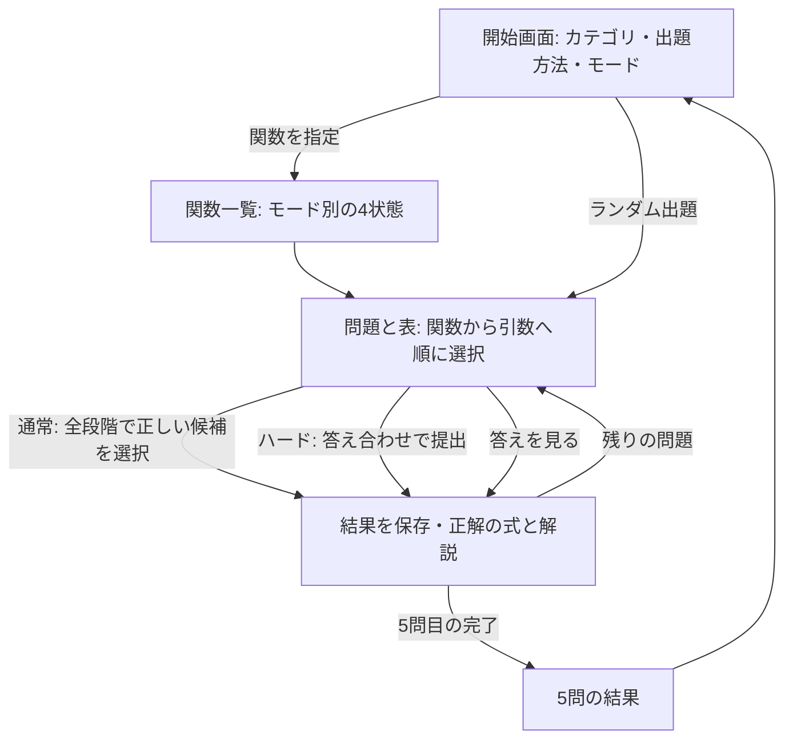

# Excel関数学習: SUM・IFの操作例

[基本仕様](function-practice-spec.md)を具体的な問題に当てはめた資料。
画面遷移・選択肢・採点・保存の期待結果を記載する。アプリの実装や実機での検証はまだ行っていない。
関数の正式なカテゴリ分けとExcelの説明文は、別途公式資料と照合する。

## 画面の流れ

通常モードは途中の誤答で同じ段階に留まり、正しい選択肢を選び直してから進む。
その問題の記録は、最終的に式を完成させても不正解とする。
ハードモードは途中の正誤を示さず、全段階を選択後に修正または提出できる。
中断したセットがある場合は、開始画面で「続きから」「新しく始める」を選べる。
新規開始時は、両モードとも未完成の問題を全て破棄する。途中の選び直しにかかわらず、その問題では成績を更新しない。
閉じるだけの場合は成績を変えず、保存した画面・段階から再開する。

## 回答画面に表示するもの

| 領域 | 内容 |
| --- | --- |
| 上半分 | 問題文、列記号・行番号付きの表。収まらない表は領域内でスクロール |
| 下半分 | 組み立て中の式、現在の段階、選択肢、必要な操作ボタン |
| 通常モードの引数説明 | Excelの説明に沿った意味を表示。以下の文言は説明用の仮文言 |
| ハードモードの引数説明 | 「第1引数」などの段階だけを表示 |
| 回答後 | 正誤、正解の式、計算結果、関数と引数の説明、該当する記号の誤り |

選択肢は原則6択・2列×3行。自然な候補が少ない引数のみ2〜5択とする。
以下は内容を示す一覧であり、実際の表示順は問題生成時に決定して保持する。
組み立て中の式は選択した文字列だけで表示し、未選択の等号や閉じ括弧などは補わない。

## 例1: SUM

問題: **全商品の売上の合計を求めてください。**

|   | A | B | C |
| --- | --- | --- | --- |
| 1 | 商品 | 売上 | 個数 |
| 2 | ノート | 1200 | 3 |
| 3 | ペン | 800 | 4 |
| 4 | ファイル | 1500 | 2 |

### 関数を選ぶ

選択肢の例:

| 候補 | 内容の確認 |
| --- | --- |
| `=SUM(` | 正しい関数と記号 |
| `=AVERAGE(` | 平均を求める関数 |
| `=MAX(` | 最大値を求める関数 |
| `SUM(` | 等号がない |
| `=SUM` | 開き括弧がない |
| `=COUNT(` | 数値セルの個数を求める関数 |

「内容の確認」列はこの資料の説明用。回答中の選択肢には表示しない。
正解の `=SUM(` を選んだ時点の式表示は、その文字列のみ。

### 第1引数を選ぶ

通常モードの意味表示例: 「合計する範囲」。
ハードモードでは「第1引数」のみ。

| 候補 | 内容の確認 |
| --- | --- |
| `B2:B4)` | 全商品の売上を含む範囲と閉じ括弧 |
| `B2:B3)` | 最後の商品が含まれない |
| `B3:B4)` | 最初の商品が含まれない |
| `C2:C4)` | 売上ではなく個数の列 |
| `B2:B4,` | 最後に不要なカンマがあり、閉じ括弧がない |
| `B2:B4` | 閉じ括弧がない |

正解の式: `=SUM(B2:B4)`

計算結果: **3500**

解説例: SUMは数値を合計する関数です。売上のあるB2からB4を範囲として指定します。
この問題では範囲を一つ指定するので、最後にカンマを付けず閉じ括弧で終えます。

## 例2: IF

問題: **得点が60以上なら「合格」、それ以外なら「不合格」とC2に表示する式を作ってください。**

|   | A | B | C |
| --- | --- | --- | --- |
| 1 | 氏名 | 得点 | 判定 |
| 2 | 佐藤 | 72 |  |
| 3 | 鈴木 | 58 |  |
| 4 | 高橋 | 60 |  |

### 関数を選ぶ

| 候補 | 内容の確認 |
| --- | --- |
| `=IF(` | 条件に応じて結果を分ける関数 |
| `IF(` | 等号がない |
| `=IF` | 開き括弧がない |
| `=SUM(` | 合計を求める関数 |
| `=COUNT(` | 数値セルの個数を求める関数 |
| `=AVERAGE(` | 平均を求める関数 |

### 第1引数を選ぶ

通常モードの意味表示例: 「判定する条件」。

| 候補 | 内容の確認 |
| --- | --- |
| `B2>=60,` | 60を含む条件と、次の引数へのカンマ |
| `B2>60,` | ちょうど60のときの判定が違う |
| `B2<=60,` | 条件の向きが違う |
| `B3>=60,` | C2と同じ行の得点を参照していない |
| `B2>=60` | 引数を区切るカンマがない |
| `B2>=60)` | 引数が残っているのに閉じ括弧で終えている |

72点の行だけでは `>` でも同じ結果になるが、問題文の「60以上」を満たさないため不正解。
60点の行も表に示し、境界値の違いを読み取れるようにする。

### 第2引数を選ぶ

通常モードの意味表示例: 「条件を満たすときの値」。

| 候補 | 内容の確認 |
| --- | --- |
| `"合格",` | 合格の文字列と次の引数へのカンマ |
| `合格,` | 文字列の引用符がない |
| `"不合格",` | 条件を満たすときの結果が違う |
| `"合格"` | 引数を区切るカンマがない |
| `"合格")` | 第3引数が残っているのに閉じ括弧で終えている |
| `"合格",,` | カンマが一つ多い |

### 第3引数を選ぶ

通常モードの意味表示例: 「条件を満たさないときの値」。

| 候補 | 内容の確認 |
| --- | --- |
| `"不合格")` | 不合格の文字列と最後の閉じ括弧 |
| `"合格")` | 条件を満たさないときの結果が違う |
| `不合格)` | 文字列の引用符がない |
| `"不合格",` | 最後に不要なカンマがあり、閉じ括弧がない |
| `"不合格"` | 閉じ括弧がない |
| `"不合格"))` | 閉じ括弧が一つ多い |

正解の選択順:

`=IF(` → `B2>=60,` → `"合格",` → `"不合格")`

完成した式: `=IF(B2>=60,"合格","不合格")`

C2の計算結果: **合格**

解説例: IFは条件に応じて結果を分ける関数です。B2が60以上なら「合格」、そうでなければ「不合格」を返します。
引数の間はカンマで区切り、文字列は引用符で囲み、最後を閉じ括弧で終えます。

## 編集と保存の確認シナリオ

以下は実装後に確認する期待結果であり、実行済みのテスト結果ではない。

| 操作 | 期待結果 |
| --- | --- |
| 通常でSUMを一度も間違えず完成 | SUM・通常の状態を正解の遷移で更新し、即保存 |
| 通常でカンマの有無を間違え、選び直して完成 | その場では「不正解」のみ。完成時にはSUM・通常を不正解として保存 |
| ハードで `=SUM(` と `B2:B4,` を選択 | 自動補完せず `=SUM(B2:B4,` を表示。提出可能で、提出後に不正解として保存 |
| ハードのIFで途中の誤答を提出前に修正して正解 | 途中の正誤は表示せず、提出した正解の式によってIF・ハードを更新 |
| IFの第1引数へ戻るだけ | 選択済みの第2・第3引数を保持 |
| IFの第1引数の値を変更 | 第2・第3引数をクリアし、順に選び直す |
| 第1引数から「戻る」 | 関数選択へ戻る。関数を変更したら全引数をクリア |
| IFの問題でSUMを選んで不正解 | IFの状態だけ更新し、SUMの状態は維持 |
| 通常で途中に間違えた後、閉じて再開 | 同じ問題と回答段階を復元し、途中に間違えた事実も保持 |
| 採点直後に閉じて再開 | 保存済みの状態と結果を復元し、正解を二重に数えない |
| 同じ関数・同じモードで2問正解し、間に別の関数を解く | その関数の状態は2連続正解になる |
| 同じ関数を通常・ハードで各1問正解 | 通常・ハードそれぞれ正解となり、合算して2連続正解にはしない |
| 2連続正解の関数で「答えを見る」 | その関数・そのモードを不正解として即保存 |
| 通常の回答中にタップ・「戻る」で再選択 | 選び直しを即時判定し、途中の誤答の有無を保持 |
| 通常で途中に間違えた後、「新しく始める」 | 未完成の現在の問題を破棄し、その問題では成績を更新しない。確定済みの回答記録は保持 |
| 誤答のない未完成問題で「新しく始める」 | 確定済みの回答記録を保持し、現在の問題では状態を更新せずに新規開始 |
| ハードの未提出問題で「新しく始める」 | 途中の選び直しで不正解にせず、現在の問題では状態を更新しない |
| 1問を確定した際に保存に失敗 | 保存失敗を表示して現在の回答を保持し、次の問題に進めず再試行できる |
| 保存を再試行して成功 | その1問の結果を一度だけ反映してから先へ進む |

誤答候補のAVERAGE・MAX・COUNTなども、ハードモードで選んだ関数の引数選択ができるようにする。
最初の出題対象がSUM・IFであることと、誤答として選択した関数の回答経路を用意することを区別する。
